# Phase 1: Core Recruiter Workspace & Foundation — Task List

**Objective:** Establish the recruiter-facing user interface shell, navigation, job selection, and static/seeded candidate browsing.

---

## Progress Overview

```mermaid
gantt
    title Phase 1 Implementation Schedule
    dateFormat  X
    axisFormat %d
    section Scaffolding
    Environment & Architecture Setup    :done, 0, 1
    section Data & Backend
    Mock Data & Seed Loader             :done, 1, 3
    FastAPI Core Endpoints              :done, 2, 4
    section Design & UI
    Design Tokens & Theme Engine        :3, 5
    App Shell & Recruiter Navigation     :4, 6
    section Dashboard Features
    Job Selection & Custom JD Input     :5, 7
    Candidate Grid & Card Components    :6, 8
    section Testing & Sign-off
    E2E Verification & DoD Sign-off     :8, 9
```

---

## Milestone 1: Project Scaffolding & Environment Setup

- [x] **Task 1.1: Backend Service Scaffolding**
  - **Path:** `backend/`
  - Initialize FastAPI project structure with `pyproject.toml` (or `requirements.txt`).
  - Configure dependencies: `fastapi`, `uvicorn`, `pydantic>=2.0`, `python-dotenv`, `pytest`, `httpx`.
  - Configure `backend/main.py` with FastAPI app instance, CORS middleware (`CORSMiddleware`), and error handling.
  - Set up configuration management (`backend/config.py`) using `pydantic-settings`.

- [x] **Task 1.2: Frontend Application Scaffolding**
  - **Path:** `frontend/`
  - Initialize Vite + React 19 + TypeScript project.
  - Set up directory structure:
    - `src/components/` (cards, dashboard, layout, common)
    - `src/context/` (ThemeContext, JobContext)
    - `src/services/` (API client & types)
    - `src/types/` (TypeScript definitions mirroring Pydantic models)
  - Configure path aliases (e.g., `@/*` $\to$ `src/*`) in `tsconfig.json` and `vite.config.ts`.

- [x] **Task 1.3: Unified Development Scripts & Environment Config**
  - Create root `.env.example` defining backend port (`8000`), frontend port (`5173`), and CORS origins.
  - Add root scripts or documentation for running backend and frontend concurrently.

---

## Milestone 2: Mock Data & Seed Loader

- [x] **Task 2.1: Data Schemas & Pydantic Models**
  - **Path:** `backend/models/job.py`, `backend/models/candidate.py`
  - Define `Job` model: `id`, `title`, `department`, `location`, `description_raw`, `created_at`, `requirements_preview`.
  - Define `CandidateSummary` model: `id`, `full_name`, `email`, `headline`, `location`, `top_skills`, `match_preview`.

- [x] **Task 2.2: Seed Data Generation**
  - **Path:** `backend/data/jobs/*.json`, `backend/data/candidates/*.json`
  - Create 4–5 realistic job descriptions:
    - *Senior Backend Distributed Systems Engineer*
    - *Full-Stack Lead (React / Python)*
    - *Frontend Specialist (Design Systems & Performance)*
    - *AI/ML Platform Engineer*
  - Create 5–6 diverse candidate seed profiles representing varied experience levels and skill combinations.

- [x] **Task 2.3: Seed Loader Service**
  - **Path:** `backend/services/seed_loader.py`
  - Implement file-backed async loader caching parsed JSON data in-memory at startup.
  - Implement query filters for job search (by keyword, department, location).

---

## Milestone 3: Backend API Endpoints (FastAPI)

- [x] **Task 3.1: Service Health & Config Endpoint**
  - **Path:** `backend/routers/health.py`
  - Implement `GET /health`:
    - Returns service status (`ok`), version (`1.0.0`), environment, and total loaded seed jobs/candidates.

- [x] **Task 3.2: Job Retrieval Endpoints**
  - **Path:** `backend/routers/jobs.py`
  - Implement `GET /jobs`:
    - Query parameters: `search` (text query), `department`, `location`.
    - Returns array of `Job` summaries.
  - Implement `GET /jobs/{job_id}`:
    - Returns single `Job` detail or `404 Not Found`.

- [x] **Task 3.3: Seeded Candidates Preview Endpoint**
  - **Path:** `backend/routers/candidates.py`
  - Implement `GET /candidates`:
    - Returns array of `CandidateSummary` objects for the dashboard card grid.
  - Implement `GET /candidates/{candidate_id}`:
    - Returns basic candidate metadata for profile shell view.

- [x] **Task 3.4: Backend Unit Tests**
  - **Path:** `backend/tests/`
  - Write test cases for `GET /health`, `GET /jobs`, `GET /jobs/{id}`, and search filtering.

---

## Milestone 4: Design Tokens & Theme Engine (Frontend)

- [x] **Task 4.1: Design Tokens & Typography**
  - **Path:** `frontend/src/index.css`
  - Implement comprehensive design system tokens using CSS Custom Properties:
    - **Color Palettes:** Curated slate/zinc neutrals, vibrant accents (indigo, emerald, amber, rose).
    - **Dark & Light Modes:** Strict contrast ratios meeting WCAG AA standards.
    - **Typography:** Import and configure Google Fonts (`Inter`), fluid font size scale, tabular numbers.
    - **Surface & Elevation:** Glassmorphism backdrop blur (`backdrop-filter`), subtle borders, soft multi-layer box shadows.
    - **Accessibility:** `@media (prefers-reduced-motion)` overrides, visible keyboard focus rings (`:focus-visible`).

- [ ] **Task 4.2: Theme Context & Toggle System**
  - **Path:** `frontend/src/context/ThemeContext.tsx`, `frontend/src/components/common/ThemeToggle.tsx`
  - Detect user system preference (`prefers-color-scheme`).
  - Persist theme selection in `localStorage`.
  - Provide smooth micro-animation transitions without layout shift.

- [ ] **Task 4.3: App Shell & Layout Navigation**
  - **Path:** `frontend/src/components/layout/AppLayout.tsx`, `frontend/src/components/layout/Header.tsx`
  - Header with Mosaic branding ("Beyond the Resume"), active role indicator pill, search trigger, and theme toggle.
  - Responsive main viewport container with proper padding and maximum content bounds.

---

## Milestone 5: Recruiter Dashboard & Job Selection

- [ ] **Task 5.1: Job Context Management**
  - **Path:** `frontend/src/context/JobContext.tsx`
  - Manage state for:
    - `selectedJob`: Active job object (or `null`).
    - `customJD`: Draft or submitted custom JD text/file data.
    - State synchronization across view navigation (dashboard $\leftrightarrow$ candidate detail).

- [ ] **Task 5.2: Job Selector Component**
  - **Path:** `frontend/src/components/dashboard/JobSelector.tsx`
  - Searchable dropdown / modal with instant search filter by title, ID, department, and location.
  - Visual badges for department and location.
  - "Clear Selection" or "Switch Job" actions.

- [ ] **Task 5.3: Custom Job Description Input Modal / Drawer**
  - **Path:** `frontend/src/components/dashboard/CustomJDModal.tsx`
  - Tabbed input:
    - **Paste Text:** Clean textarea with line numbers/word counter and formatting cleanup.
    - **Upload File:** Drag-and-drop zone accepting `.txt`, `.pdf`, `.docx` (with mock/stub file reader for Phase 1).
  - Validation: Ensure minimum JD text length before applying.
  - "Set as Active Job" button triggering `JobContext` update.

---

## Milestone 6: Candidate Cards & Grid View

- [ ] **Task 6.1: Candidate Card Component**
  - **Path:** `frontend/src/components/cards/CandidateCard.tsx`
  - Display candidate avatar/initials, full name, professional headline, and location.
  - Skill pills with overflow count indicator (`+N more`).
  - Match placeholder badge indicating awaiting Phase 2/3 deterministic scoring engine.
  - Hover elevation, micro-interactions, and accessible keyboard focus state.
  - "View Profile" action linking to Candidate Detail Shell.

- [ ] **Task 6.2: Candidate Grid & Search Filter Container**
  - **Path:** `frontend/src/components/dashboard/CandidateGrid.tsx`
  - Responsive auto-fill grid layout (1 column on mobile, 2 on tablet, 3 on desktop).
  - Quick filter bar: search candidates by name, email, or skill tags.
  - Empty state with clear call-to-action when no candidates match filters.
  - Skeleton loading placeholders during API fetch.

- [ ] **Task 6.3: Candidate Detail Navigation Shell**
  - **Path:** `frontend/src/components/profile/CandidateProfileShell.tsx`
  - Placeholder detail view demonstrating that the active job selection context is retained when switching views.
  - "Back to Dashboard" navigation link preserving active job state.

---

## Milestone 7: Testing & Acceptance Sign-off

- [ ] **Task 7.1: Frontend Unit & Accessibility Testing**
  - Test `ThemeContext` toggles and local storage persistence.
  - Test `JobSelector` search filtering.
  - Test keyboard navigation across interactive elements (`Tab`, `Enter`, `Escape`).

- [ ] **Task 7.2: Definition of Done Verification**
  - [ ] Recruiter can launch app and smoothly toggle between light and dark modes.
  - [ ] Recruiter can search, view, and select from sample jobs or input custom JD text.
  - [ ] Candidate cards render seeded candidate records with responsive styling.
  - [ ] Navigating between dashboard and candidate profile preserves the active job context.
  - [x] Backend health (`/health`) and jobs endpoints (`/jobs`, `/jobs/{id}`) respond cleanly.
