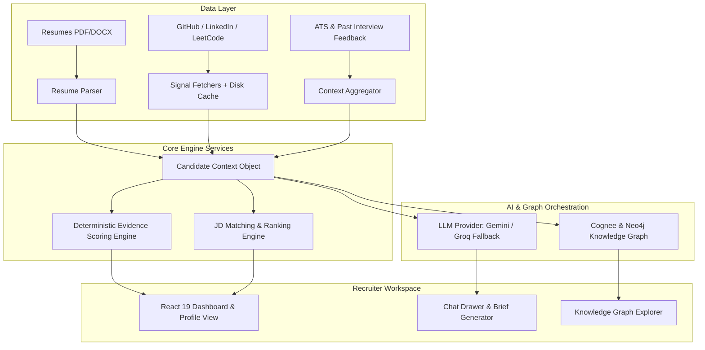
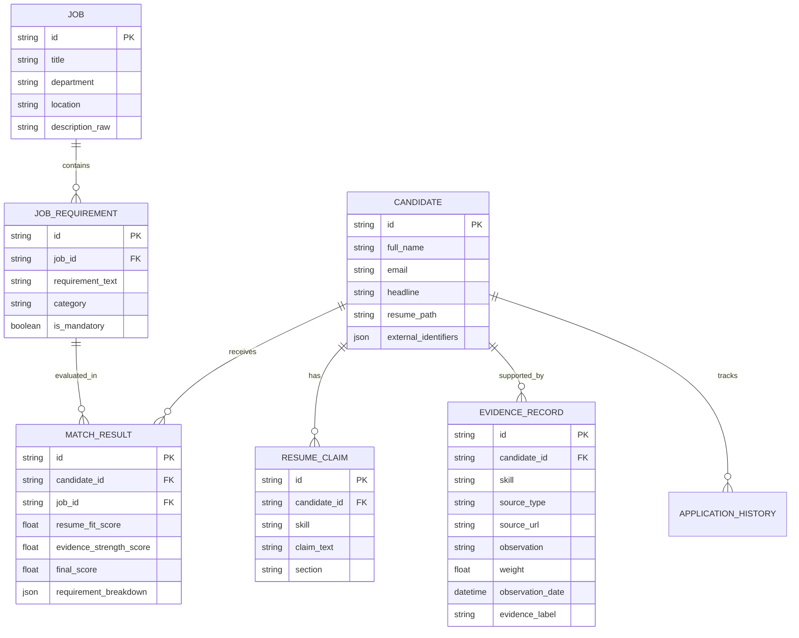

# Product Requirements Document (PRD)
## Skilltrace - Trace Skills to Evidence

Skilltrace is the current frontend brand; backend modules and configuration retain the Mosaic name.

**Version:** 1.2
**Status:** Implementation-aligned roadmap (reviewed 2026-10-26)
**Product Category:** AI-Powered Candidate Intelligence & Evidence-Based Recruitment
**Primary Users:** Recruiters, Talent Acquisition Teams, Hiring Managers

---

## 1. Executive Summary

Mosaic is an AI-powered candidate intelligence platform that consolidates fragmented candidate information into a unified, evidence-backed profile.

Recruiters frequently evaluate candidates across disconnected sources: resumes, ATS records, past application history, interview feedback, GitHub repositories, coding platforms (LeetCode), and professional profiles. This fragmentation makes it difficult to assess real experience and alignment with job requirements.

Mosaic creates a candidate context layer that connects these sources, evaluates available evidence against specific job requirements using deterministic scoring, and presents findings through an interactive recruiter workspace.

### Core Capabilities
* **Job Matching:** Compare candidates directly against job description requirements.
* **Evidence Attribution:** Inspect verifiable evidence trails behind individual resume claims.
* **Historical Memory:** Retain company-specific application history and interview feedback across hiring rounds.
* **Gap Identification:** Explicitly highlight unverified claims and skill gaps without negative bias.
* **Recruiter Deliverables:** Generate evidence-backed executive briefs and gap-targeted interview questions.
* **Agentic Exploration:** Query candidate depth via a conversational AI assistant and interactive knowledge graph.

> **Foundational Principle:** Mosaic informs human hiring decisions through transparent, verifiable evidence. It never automates hiring or rejection decisions.

---

## 2. Product Vision & Five Core Questions

**Beyond the Resume: turn fragmented candidate signals into actionable, evidence-backed hiring context.**

Mosaic answers five core questions during candidate evaluation:
1. **What does the candidate claim?** (Extracted from resume and submitted projects)
2. **What available evidence supports that claim?** (GitHub repositories, LeetCode activity, interview notes)
3. **How does that evidence relate to the target role?** (Requirement coverage against the JD)
4. **What remains unverified or unknown?** (Information gaps without assuming dishonesty)
5. **What should the interviewer validate next?** (Gap-targeted interview questions)

---

## 3. System Architecture & Tech Stack

* **Frontend:** React 19, TypeScript, Vite, CSS design tokens and Tailwind utilities compiled through PostCSS at build time.
* **Backend:** Python, FastAPI, Pydantic v2.
* **AI Providers:** Google Gemini (Primary), Groq (High-Speed Fallback), Ollama (Local Development).
* **Graph Database:** Neo4j Aura + Cognee framework (asynchronous seeding).
* **Storage Strategy:** Disk cache & in-memory stores for prototype MVP $\to$ Persistent Relational DB (PostgreSQL) for production.

---

## 4. Phase-Wise Implementation Roadmap

The five phases below distinguish implemented UI from working intelligence services. A visible badge, tab, or button does not establish backend completion.

| Phase | Scope aligned with current UI | Current status |
|:---|:---|:---|
| 1 | Skilltrace light workspace, sidebar/header, overview, active requisition, custom JD, candidate pool and profile tabs | Implemented with distinct views, responsive shell, accessible controls and verified seeded-data workflows |
| 2 | Resume ingestion, external signals, evidence audit trails and unified candidate context | Planned; seeded claims, skills, links and evidence badges already have UI surfaces |
| 3 | JD extraction, role-specific matching, requirement coverage and deterministic ranking | Planned; current match previews do not change with the active job |
| 4 | Candidate assistant, interview briefs/questions, digest export and knowledge graph | Planned; brief/export controls are currently inactive |
| 5 | Persistence, authentication, permissions, privacy and production delivery | Planned; custom jobs currently exist only in browser memory |

See [PHASE_1_TASKS.md](PHASE_1_TASKS.md) for implemented tasks and the remaining foundation backlog.

### Phase 1: Core Recruiter Workspace & Foundation

**Objective:** Deliver the Skilltrace light-mode recruiter workspace with seeded API data and preserved active-requisition context.

#### Functional Requirements Included
* **FR-01 (Part 1): Recruiter Dashboard:**
  * Fixed 240px sidebar, 56px header, breadcrumbs and recruiter identity placeholder.
  * Overview metrics, active requisition metadata and requirement preview chips.
  * Candidate search, skill filters, reset controls, result count and responsive card grid.
  * Candidate detail tabs: Evidence & Claims, Reported Skills, and Background Summary. Content is seeded; tab names do not imply completed verification.
* **FR-12 (Part 1): Job Search & Retrieval:**
  * Search the job dropdown by ID, title, department and location; select an active job.
  * Custom JD modal with title, department, sample-fill, word/character counts and minimum 50-character validation.
  * Create custom jobs in React state and retain selection during profile navigation. Refresh persistence is future work.
  * Upload tab supports TXT/MD/PDF/DOCX extraction, drag/drop, file-size/format validation and readable error states. Scanned PDFs need pasted text.
* **FR-14: User Interface:**
  * Light-only purple/neutral design with Inter, JetBrains Mono, Material Symbols, status badges, focus-visible and reduced-motion CSS.
  * Dark mode and persistent theme preferences are outside the current UI baseline.

#### Technical Components
* **Frontend:**
  * `App.tsx`, `components/layout/Sidebar.tsx`, `components/layout/Header.tsx`: Workspace shell and view state.
  * `components/dashboard/DashboardOverview.tsx`: Metrics, active requisition and candidate pool.
  * `components/dashboard/JobSelector.tsx`, `CustomJDModal.tsx`: Job switching and custom JD entry.
  * `components/dashboard/CandidateGrid.tsx`, `components/cards/CandidateCard.tsx`: API-backed filtering, cards and loading/error/empty states.
  * `components/profile/CandidateProfileShell.tsx`: API-backed profile and seeded tabs.
  * `context/JobContext.tsx`: Jobs, selection, custom JD, search, skill and candidate navigation state. No ThemeContext exists.
  * `services/api.ts`, `types/`, `index.css`, `frontend/index.html`: Typed API client, schemas, tokens and build-time utility styling.
* **Backend:** FastAPI, Pydantic models, synchronous file-backed seed loader cached in memory, five seed jobs and six candidates.
* **Implemented API:** `GET /health`, `GET /api/v1/jobs`, `GET /api/v1/jobs/{job_id}`, `GET /api/v1/candidates`, `GET /api/v1/candidates/{candidate_id}`. Unprefixed aliases also exist.

#### Delivered Behavior & Acceptance Criteria
1. Distinct Overview, Jobs and Candidates views work. Evidence Explorer is explicitly reserved for Phase 2.
2. Job loading/errors/retry and clear selection are visible. Job-ID search is implemented in the dropdown and backend.
3. The sidebar/header adapt to narrow screens. Candidate and profile layouts and the scrollable JD dialog are browser-tested.
4. Dialog labels, focus trap/restoration, Escape, dropdown arrow keys and Ctrl/Cmd+K search are implemented. Contrast was corrected and automated accessibility scans pass for the checked screens.
5. Static activity counts are removed. Match/verification states are unassessed or seeded previews; no default 60% fit or fabricated years of experience are shown.
6. Sample/custom job selection, candidate search/filter/reset, profile tabs and return navigation retain job context. Verification includes backend tests, frontend interactions and live desktop/mobile browser workflows; see PHASE_1_TASKS.md.

---

### Phase 2: Candidate Ingestion & Evidence Scoring Engine

**Objective:** Ingest unstructured resumes, fetch verified external signals, calculate deterministic evidence scores, and assemble unified candidate contexts.

#### Functional Requirements Included
* **FR-02: Resume Ingestion & Candidate Records:**
  * Parse PDF, DOCX, and TXT resumes.
  * Extract candidate identity, work history, projects, skills, and claim statements.
  * Deduplication logic to prevent multiple records for the same candidate.
* **FR-03: External Signal Integration:**
  * **GitHub:** Public repos, language breakdown, commit activity, topic tags.
  * **LinkedIn:** Headline, professional profile verification.
  * **LeetCode:** Solved problems, language proficiencies, contest metrics.
  * Graceful fail-soft handling: network failure or absent profile never crashes the pipeline.
* **FR-04: Evidence Scoring Engine:**
  * Deterministic calculation based on empirical weights and recency decay.
  * Absolute separation: LLMs explain evidence, but deterministic math calculates scores.
* **FR-05: Candidate Context Layer:**
  * Assemble identity, claims, external signals, application history, and interview feedback into a single canonical `CandidateContext` JSON object.
* **FR-13: Data Caching & Signal Freshness:**
  * Disk-backed cache for external retrievals to avoid rate-limiting.
  * Non-destructive cache refresh with timestamp tracking.

#### Scoring Rules & Formulas

$$\text{Evidence Score} = \sum (\text{Base Signal Weight} \times \text{Recency Multiplier})$$

| Signal Type | Base Weight |
|:---|:---:|
| Matching GitHub repo primary language | 3 |
| Verified project stack submission | 3 |
| Positive previous interview feedback | 3 |
| GitHub repository mention / readme topic | 2 |
| Recent active GitHub commit in skill | 2 |
| LeetCode activity in specific language | 1 |
| LinkedIn headline / about mention | 1 |
| Negative previous interview feedback | 0 |

| Evidence Recency | Multiplier |
|:---|:---:|
| $< 6$ months | 1.0 |
| $6 – 18$ months | 0.7 |
| $18 – 36$ months | 0.4 |
| $> 36$ months | 0.2 |
| Undated / unknown | 0.7 |

| Cumulative Raw Score | Evidence Label | Visual Indicator |
|:---|:---|:---:|
| `0` | No public evidence | Gray |
| `1 – 2` | Limited | Yellow |
| `3 – 5` | Some | Blue |
| `6 – 9` | Good | Indigo |
| `10+` | Strong | Emerald |

#### Technical Components
* **Backend:**
  * `services/resume_parser.py`: Text and structured entity extraction.
  * `services/signal_fetchers/`: Independent collectors (`github.py`, `linkedin.py`, `leetcode.py`).
  * `services/scoring_engine.py`: Pure deterministic mathematical scoring module.
  * `services/context_builder.py`: Context aggregator generating `CandidateContext`.
  * Endpoints:
    * `GET /candidates`: List all parsed candidates.
    * `GET /candidates/{id}/context`: Retrieve unified candidate context object.
    * `GET /candidates/{id}/resume`: Retrieve original resume text/file.
    * `POST /seed/rebuild`: Invalidate caches and reload seeded records.
* **Frontend:**
  * `components/evidence/EvidenceBar.tsx`: Tiered color-coded evidence score bar.
  * `components/evidence/EvidenceCard.tsx`: Expandable drawer showing sources, timestamps, and observations.
  * Extend existing Evidence & Claims / Reported Skills tabs with source observations, timestamps, verification status and audit trails; replace the explicit unverified preview labels only when evidence exists.
  * Implement the Evidence Explorer destination currently marked as Phase 2.
  * `components/profile/ResumeViewer.tsx`: Original resume viewer connected to the existing Resume Reference action.
  * Reuse the implemented JD document parsing where appropriate, while keeping candidate resume ingestion and structured extraction separate.

#### Acceptance Criteria & Definition of Done
1. Uploaded/seeded resumes produce structured candidate models without hallucinations.
2. Missing external profiles display as "No public evidence" rather than an error or negative penalty.
3. Identical candidate claims and evidence always produce identical numerical scores.
4. Every evidence label links directly to the specific raw observation and source URL.

---

### Phase 3: JD Matching, Requirement Extraction & Candidate Ranking

**Objective:** Deconstruct job descriptions into discrete requirements, match against candidate context, and compute explainable dual-axis candidate rankings.

#### Functional Requirements Included
* **FR-06: Job Description Matching:**
  * Extract 5–10 core requirements (distinguishing mandatory vs. preferred).
  * Match each requirement against candidate resume claims AND external evidence.
  * Generate an evidence-backed narrative per requirement.
* **FR-07: Candidate Ranking Engine:**
  * Rank all candidates against the active JD using the dual-axis formula:
    $$\text{Final Score} = 0.5 \times \text{Resume Fit} + 0.5 \times \text{Evidence Strength}$$
    * $\text{Resume Fit}$: Proportion of extracted requirements satisfied by resume claims.
    * $\text{Evidence Strength}$: Normalized score of supporting external signals for those requirements.
* **FR-08: Candidate Profile — JD Match Tab:**
  * Requirement coverage breakdown (Matched, Partially Supported, Insufficient Evidence).
  * Expandable source audit trail per requirement.
* **FR-12 (Part 2): Similar Job Discovery:**
  * Find related openings using requirement overlap.

#### Technical Components
* **Backend:**
  * `services/job_matcher.py`: Requirement extraction and dual-axis ranking algorithm.
  * Skill taxonomy mapping for alias resolution (e.g., `React.js` $\leftrightarrow$ `React`).
  * Endpoints:
    * `POST /jd/extract`: Parse requirements from pasted text or uploaded JD.
    * `POST /jd/rank`: Evaluate and rank all candidates for a specific job.
    * `POST /candidates/{id}/jd-match`: Return detailed requirement breakdown for a candidate.
    * `POST /jd/similar`: Calculate requirement overlap across other job openings.
* **Frontend:**
  * `components/matching/LiveJDMatchingView.tsx`: Visual matrix of requirements vs. candidate coverage.
  * `components/profile/JDMatchTab.tsx`: Detailed alignment tab on the candidate profile.
  * `components/dashboard/RequirementFilter.tsx`: Filter candidate cards by specific requirement badges.
  * Connect active job changes to ranking and card match previews; replace Role fit pending only after computing a real score. Current skill filtering is not requirement matching.
  * Replace custom JD newline previews with extracted requirements while preserving the current requisition summary.

#### Acceptance Criteria & Definition of Done
1. System extracts discrete requirements from arbitrary JD inputs.
2. Candidate ranking is 100% reproducible for identical JD + candidate inputs.
3. Recruiters can view exactly why a candidate ranked at their position (inspecting the fit vs. evidence breakdown).
4. Uncovered requirements are distinctly labeled as "Requires validation" rather than silently ignored.

---

### Phase 4: Conversational AI Intelligence & Knowledge Graph

**Objective:** Layer interactive conversational exploration, automated recruiter deliverables (briefs & interview questions), and graph-based entity navigation.

#### Functional Requirements Included
* **FR-09: Conversational AI Agent:**
  * Candidate-aware and job-aware chat assistant.
  * Resolves candidate identity before answering candidate-specific questions.
  * Tool-calling loop bounded to a maximum of 5 iterations to prevent infinite loops.
  * Strict source-grounding: answers must cite retrieved candidate context.
* **FR-10: Executive Brief & Interview Question Generator:**
  * **Executive Brief:** 1-page summary covering strengths, verified evidence, previous interactions, and gaps.
  * **Interview Questions:** Questions tailored specifically to unevidenced claims and historical interview feedback.
* **FR-11: Knowledge Graph Representation:**
  * Isolated candidate subgraphs linking skills, repos, past roles, and JD requirements.
  * Graph ingestion performed during background seeding via Cognee & Neo4j Aura.

#### Technical Components
* **Backend:**
  * `services/llm/provider.py`: Unified interface for Google Gemini with Groq fallback.
  * `services/agent/orchestrator.py`: Multi-turn conversational loop with function calling.
  * `services/agent/tools.py`: Tools for candidate lookup, context retrieval, evidence inspection, and JD comparison.
  * `services/graph/neo4j_client.py`: Graph query and subgraph extraction.
  * Endpoints:
    * `POST /agent/chat`: Conversational agent endpoint with history.
    * `POST /candidates/{id}/brief`: Generate executive candidate summary.
    * `POST /candidates/{id}/interview-questions`: Generate targeted interview question set.
    * `GET /candidates/{id}/graph`: Retrieve candidate subgraph nodes and relationships.
    * `POST /candidates/{id}/graph-evidence`: Graph-backed evidence extraction.
* **Frontend:**
  * `components/agent/ChatDrawer.tsx`: Slide-over conversational assistant drawer.
  * `components/profile/BriefQuestionsTab.tsx`: Formatted printable/exportable brief and questions.
  * `components/graph/GraphVisualization.tsx`: Interactive node-link visualization.
  * Enable interview brief generation and add digest export controls to grounded deliverables and working downloads.

#### Acceptance Criteria & Definition of Done
1. Recruiter can ask natural language questions ("Does Alex have real production experience with Kubernetes?") and receive answers citing specific repos/interview notes.
2. The AI agent refuses to fabricate unevidenced facts and explicitly highlights unknown data.
3. Executive briefs and interview questions generate in $< 3$ seconds.
4. If Neo4j or Cognee is unavailable, the core context, scoring, and chat assistant continue functioning.

---

### Phase 5: Production Readiness, Security & Compliance

**Objective:** Transition from prototype data structures to enterprise-grade persistence, authentication, role-based access control, privacy safeguards, and automated quality benchmarking.

#### Non-Functional & Hardening Requirements Included
* **Data Persistence:**
  * Migrate from in-memory/JSON stores to a persistent relational database (PostgreSQL with Prisma/SQLAlchemy).
* **Security & Access Control (RBAC):**
  * Authentication (OAuth2 / JWT / Clerk).
  * Role permissions:
    * *Recruiter*: View all candidates, generate briefs, run JD matches.
    * *Hiring Manager*: View assigned role candidates, inspect evidence, view interview questions.
    * *HR Administrator*: Manage candidate records, audit logs, system configuration.
* **Privacy & Compliance:**
  * Separation of synthetic demo data from confidential candidate PII.
  * GDPR/CCPA compliance: Candidate data deletion and audit trail.
  * Clear data retention windows for external cached signals.
* **Evaluation Suite & Benchmarks:**
  * Automated testing harness evaluating ranking stability and extraction precision against expert human evaluations.

#### Technical Components
* **Backend:**
  * Database schema migrations and connection pooling.
  * `core/security.py`: Auth middleware, password hashing, token validation.
  * Audit logging middleware capturing data view and export events.
  * Automated test suite (`pytest`) covering:
    * Mathematical scoring logic and recency multipliers.
    * Ambiguous identity resolution safety.
    * LLM prompt injection and hallucination boundaries.
* **Frontend:**
  * Authentication provider wrapper and protected route guards.
  * User profile management and tenant switcher; replace the static recruiter identity and wire profile/notification controls.
  * Persist custom jobs through a backend write API and database; current frontend creation never calls the backend.
  * Build-time Tailwind is already implemented; harden deployment and verify production asset/font delivery.

#### Acceptance Criteria & Definition of Done
1. Zero sensitive candidate data or API keys exposed in client bundles or public endpoints.
2. Complete test suite passes with $> 85\%$ coverage on scoring, ranking, and context generation.
3. Access control prevents unauthorized roles from viewing restricted candidate records.
4. System satisfies data deletion requests within a single transaction.

---

## 5. API Endpoint Matrix by Phase

Phase 1 routes are implemented. Phase 2-5 routes below are planned contracts, not existing endpoints.

| Phase | Method | Endpoint | Description |
|:---:|:---|:---|:---|
| **Phase 1** | `GET` | `/health` | Service health status and active configuration |
| **Phase 1** | `GET` | `/api/v1/jobs` | Implemented job listing; `/jobs` alias |
| **Phase 1** | `GET` | `/api/v1/jobs/{job_id}` | Implemented job detail; `/jobs/{job_id}` alias |
| **Phase 1** | `GET` | `/api/v1/candidates` | Implemented seeded summaries with search/skill filters; `/candidates` alias |
| **Phase 1** | `GET` | `/api/v1/candidates/{candidate_id}` | Implemented seeded candidate details; unprefixed alias |
| **Phase 2** | `GET` | `/candidates/resolve` | Resolve candidate ID by name/email |
| **Phase 2** | `GET` | `/candidates/{id}/context` | Retrieve assembled CandidateContext JSON |
| **Phase 2** | `GET` | `/candidates/{id}/resume` | Retrieve original resume document |
| **Phase 2** | `POST` | `/seed/rebuild` | Invalidate caches and re-seed sample data |
| **Phase 3** | `POST` | `/jd/extract` | Extract structured requirements from raw JD text/file |
| **Phase 3** | `POST` | `/jd/rank` | Rank candidates against specified job description |
| **Phase 3** | `POST` | `/candidates/{id}/jd-match` | Generate requirement-level match report |
| **Phase 3** | `POST` | `/jd/similar` | Discover similar job openings |
| **Phase 4** | `POST` | `/agent/chat` | Multi-turn conversational candidate intelligence |
| **Phase 4** | `POST` | `/candidates/{id}/brief` | Generate evidence-grounded executive brief |
| **Phase 4** | `POST` | `/candidates/{id}/interview-questions` | Generate gap-targeted interview questions |
| **Phase 4** | `GET` | `/candidates/{id}/graph` | Retrieve candidate knowledge subgraph |
| **Phase 4** | `POST` | `/candidates/{id}/graph-evidence` | Query graph for claim corroboration |
| **Phase 5** | `POST` | `/auth/login` | User authentication & JWT issuance |
| **Phase 5** | `POST` | `/candidates/{id}/delete` | GDPR compliant candidate data purge |

---

## 6. Logical Data Entities

---

## 7. Risks & Mitigations

| Risk | Impact | Phase | Mitigation Strategy |
|:---|:---:|:---:|:---|
| **Bias against private/enterprise devs** | High | Phase 3 | Explicitly label missing public signals as "Unassessed / Needs validation" rather than penalizing candidate competence. Allow role-based weighting overrides. |
| **External API rate limits / blockages** | High | Phase 2 | Use aggressive disk-based caching and mock adapters for demo and fallback environments. |
| **LLM hallucination in candidate claims** | Critical | Phase 4 | Enforce strict citation requirements: the agent can only reference assertions present in the verified `CandidateContext`. |
| **Slow graph traversal latency** | Medium | Phase 4 | Keep graph ingestion in background seeding tasks. Ensure direct context and scoring run completely independent of graph availability. |
| **Data privacy / PII exposure** | Critical | Phase 5 | Mask PII in non-authorized views; implement strict audit logs for any export or view of candidate records. |

---

## 8. Definition of Done Summary

A phase is considered **Done** only when:
1. All functional requirements allocated to that phase have corresponding unit and integration tests.
2. Mathematical scores and match evaluations are verifiable and deterministic.
3. Code changes do not break fail-soft fallbacks (direct context operates without graph or external APIs).
4. The user interface updates reflect live state transitions without UI freezing or uncaught exceptions.
